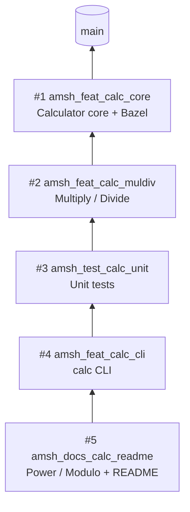

# PR_Feature

Learning project for **stacked (dependent) pull requests**, built around a
small C++ `Calculator` library compiled with a hermetic Bazel toolchain.

## Build

| Item | Value |
|------|-------|
| Bazel | 9.3.1, pinned in `.bazelversion` (use `bazelisk`) |
| C++ toolchain | Hermetic LLVM 22.1.8 via `toolchains_llvm` (host compiler detection disabled) |
| Language | C++17, `-Wall -Wextra -Werror` |
| Tests | GoogleTest |

```bash
bazel build //...                 # build everything
bazel test //...                  # run unit tests
bazel run //app:calc -- 6 / 3     # -> 2
```

The first build downloads LLVM (~1 GB); later builds use the Bazel cache.

### CLI operators

| Op | Operation | Example | Result |
|----|-----------|---------|--------|
| `+` | Add | `2 + 3` | `5` |
| `-` | Subtract | `5 - 3` | `2` |
| `x` | Multiply (`*` needs quoting) | `4 x 2.5` | `10` |
| `/` | Divide | `6 / 3` | `2` |
| `^` | Power | `2 ^ 10` | `1024` |
| `%` | Modulo (floating-point) | `7 % 3` | `1` |

Division or modulo by zero prints an error and exits with code 1.

### Layout

```
.bazelrc / .bazelversion / MODULE.bazel   build configuration
calculator/   cc_library //calculator, cc_test //calculator:calculator_test
app/          cc_binary  //app:calc
```

## The PR stack

Each PR is branched from the previous one and uses it as its **base**, so
each PR's diff shows only its own change.



`main` is the default branch of this repository.

### Creating a stacked PR

```bash
git checkout amsh_feat_calc_core          # parent branch
git checkout -b amsh_feat_calc_muldiv     # child branch
# ... edit, build, test, commit ...
git push -u origin amsh_feat_calc_muldiv
```

In the GitHub UI open the PR with **base = parent branch** (not `main`) and
write `Depends on #<parent>` in the description.

### Updating a lower PR after review

If review feedback changes PR *N*, propagate it up the stack:

```bash
git checkout amsh_feat_calc_core && git commit ... && git push
git checkout amsh_feat_calc_muldiv && git merge amsh_feat_calc_core && git push
# repeat for each branch above it
```

Merging (rather than rebasing) avoids force-pushes on branches that are
already under review.

## Merging a stack: three strategies

Prerequisite: **Settings → General → Pull Requests** must allow *merge
commits* and *squash merging*, and *Automatically delete head branches*
is recommended. When a PR's head branch is deleted after merge, GitHub
automatically retargets the PRs that were based on it to the merged-into
branch.

This repository uses all three strategies:

| PRs | Strategy |
|-----|----------|
| #1, #2 | A — bottom-up merge commits + retarget |
| #3 | C — squash merge + `git rebase --onto` |
| #4, #5 | B — fold top into bottom, single merge |

Always merge in order **bottom → top**; never merge a PR whose base is
not yet merged unless you intend to fold it (strategy B).

### Strategy A — bottom-up merge commit + retarget

Merge the lowest PR into `main` with **Create a merge commit**, delete its
branch, and let GitHub retarget the next PR to `main`. Repeat.

1. PR #1 → **Create a merge commit** → **Delete branch**.
2. PR #2 is retargeted to `main` automatically (otherwise: *Edit* → change
   base to `main`). Its diff is unchanged because the commits of #1 are
   now in `main` with the same SHAs.
3. PR #2 → **Create a merge commit** → **Delete branch**. PR #3 is
   retargeted to `main`.

| Pros | Cons |
|------|------|
| No local git work, no force-push | One merge commit per PR (busier history) |
| Commit SHAs preserved; upper PRs need no rebase | Every PR must be reviewed and merged in sequence |

### Strategy C — squash merge + `rebase --onto`

Squashing creates a **new** commit on `main`; the original commits of the
squashed PR are still in every branch above it. Git does not know they
are the same change, so the next PR would show them again or conflict.
`git rebase --onto` drops them.

1. PR #3 → **Squash and merge** → **Delete branch**. PR #4 is retargeted
   to `main` but now shows the PR #3 commits too.
2. Rewrite PR #4 onto the new `main`, dropping the PR #3 commits:

   ```bash
   git fetch origin
   OLD_PR4=$(git rev-parse amsh_feat_calc_cli)   # needed for PR #5
   # rebase --onto <new base> <old base (exclusive)> <branch>
   git rebase --onto origin/main amsh_test_calc_unit amsh_feat_calc_cli
   bazel test //...
   git push --force-with-lease origin amsh_feat_calc_cli
   ```

3. Do the same for PR #5 (its old base is the pre-rebase PR #4 tip):

   ```bash
   git rebase --onto amsh_feat_calc_cli "$OLD_PR4" amsh_docs_calc_readme
   bazel test //...
   git push --force-with-lease origin amsh_docs_calc_readme
   ```

4. Check that the *Files changed* tab of PR #4 and PR #5 shows only their
   own changes.

| Pros | Cons |
|------|------|
| One clean commit per PR on `main` | Requires local rebase + force-push of every PR above |
| Linear, readable history | Rewrites SHAs; reviewers' local checkouts go stale |

`--force-with-lease` refuses to overwrite the remote if someone else
pushed to the branch in the meantime; never use plain `--force`.

### Strategy B — fold the top into the bottom, merge once

Merge the upper PR into its base branch first, then merge the combined
lower PR into `main` once.

1. PR #5 (base `amsh_feat_calc_cli`) → **Create a merge commit**. PR #5 is
   now *merged* into PR #4's branch, which contains both changes.
2. Re-run `bazel test //...` on `amsh_feat_calc_cli`.
3. PR #4 (base `main`) → **Create a merge commit** (or squash) →
   **Delete branch**.

| Pros | Cons |
|------|------|
| Single merge into `main`; one CI run on the combined result | `main` receives a large change at once |
| No rebase, no force-push | PR #5 shows "merged" into a feature branch, not `main` |
| Good when the upper PRs are small or tightly coupled | Lower PR must not be merged before the upper ones are folded in |

### Choosing a strategy

| Situation | Use |
|-----------|-----|
| Repository allows merge commits, want minimal effort | A |
| Repository enforces squash / linear history | C |
| Several small PRs that only make sense together | B |

### Verify after merging

```bash
git checkout main && git pull
git log --graph --oneline main
bazel test //... && bazel run //app:calc -- 2 ^ 10
```

The graph shows the three shapes: two merge bubbles (A), one squashed
commit (C), and one merge bubble containing PR #4 and the PR #5 merge (B).
